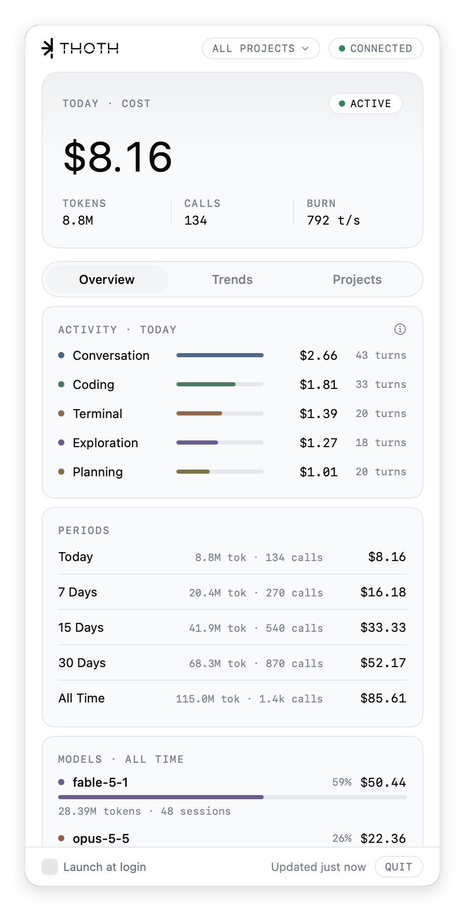

# Thoth

[](https://github.com/carloscostadev/thoth/releases/latest)
[](https://github.com/carloscostadev/thoth/releases)
[](LICENSE)


Named after Thoth, the Egyptian god of writing and measure.

A lightweight macOS menu bar app that turns the JSONL logs Claude Code writes
to disk into a live view of your usage: tokens, costs, activity breakdown,
project ranking, daily trends and burn rate.

No API keys. No network requests. No telemetry. Everything is read locally
from `~/.claude/`.

<p align="center">
  <picture>
    <source media="(prefers-color-scheme: dark)" srcset="docs/images/popover-dark.png">
    <source media="(prefers-color-scheme: light)" srcset="docs/images/popover-light.png">
    
  </picture>
  <br>
  <sub>Illustrative data.</sub>
</p>

## Quick start

1. Download from [Releases](https://github.com/carloscostadev/thoth/releases/latest)
2. Drag `Thoth.app` to `/Applications`
3. Open it once and allow it in **System Settings > Privacy & Security >
   Open Anyway** (see [Install](#install))
4. Click the icon in the menu bar

## Features

- **Today, 7, 15 and 30 days, all time.** Cost, calls and tokens for each
  window, all on one screen. Rolling windows count today as day one.
- **Live burn rate.** Tokens/second with activity states: Sleeping, Idle,
  Active, Sprinting.
- **Activity breakdown.** What you're actually doing today (Conversation,
  Coding, Exploration, Terminal, Planning, Design), classified from the tools
  used in each assistant turn. The ⓘ next to the section lists the rule for
  each category: it's an inference from tool calls, not a measure of time or
  intent.
- **Model breakdown.** Per-model cost and token share (Fable, Mythos, Opus,
  Sonnet, Haiku), priced with a built-in copy of Anthropic's API list prices
  (last checked 2026-10-23, Claude 5 family included). A model version
  without its own price in the table uses the closest known version of its
  family until the app is updated; such rows are marked ≈ with the reference
  rates used (e.g. "≈ opus-5-5 rates"). A Claude model of a family the table
  doesn't know (e.g. `claude-nova-1`) still counts in tokens and calls, at a
  cost of $0: its row is marked ? with "no known price", and the cost totals
  leave it out. Costs are API-equivalent estimates, not what a Claude
  subscription bills you.
- **Data status.** The footer shows when the history was last read ("Updated
  just now"). While the first read runs (with a file count), when
  `~/.claude/projects` doesn't exist, can't be read, or some transcripts
  couldn't be read, a notice says so. Until a read succeeds, today's figures
  show "—" and the tabs hold no lists, only a "—" card saying why, so a real
  `$0.00` never looks like a failed read. A partial read keeps its figures,
  with the notice.
- **Trends tab.** Last-30-days daily cost chart, projected month-end cost and
  prompt-cache savings.
- **Projects tab.** Top projects by cost (resolved from each session's first
  `cwd`, not just the encoded folder name; git worktrees, Horus parallel
  worktrees and Claude Code scratchpads count under their project), plus a
  weekday × hour heatmap of when you burn the most.
- **Project filter.** A chip in the popover header ("All projects" by
  default) opens a menu of the projects in your history, the same groups as
  the Projects tab. Picking one filters every number: today's figures and
  activity, the periods, models, trends, the ranking and the heatmap. The chip
  stays visible on every tab and turns blue (accent dot and border) while a
  project is selected, so filtered numbers aren't mistaken for the total. The
  choice is remembered between launches; if that project no longer appears
  in a complete read of the history, the filter goes back to "All projects".
  A project without use in a period shows a real `$0.00`, with the usual
  data status notice if a read failed.
- **Menu bar mark.** Full while Claude Code is working, dimmed while it
  sleeps. No animation, so it costs nothing between state changes.
- **Launch at login.** Optional, toggled from the popover.

## How it works

Claude Code writes one JSONL file per session under
`~/.claude/projects/<encoded-cwd>/<session-id>.jsonl`. Thoth polls that
tree and the `~/.claude/sessions/*.json` heartbeats, aggregates the
`message.usage` of every API response, and prices it against a built-in rate
card. Claude Code writes one line per content block with the same
`message.id`, and streams `output_tokens` up to the final count on the last
one, so every response is counted once, with its final values.

A resumed or forked session can start a new transcript that repeats responses
already logged in the one it came from. Each response is identified by its
`message.id` and `requestId` (either one when the other is missing), and every
scan (heavy, today, active-session poll) checks one shared registry of which
transcript counts it, so a copy in another file is not counted again. A
response counts in the transcript where it appears first by timestamp, ties
going to the path that sorts first, so the project it lands in depends only on
the files, never on the order they're read in: when a better copy turns up
later, the transcript that had it is summed again without it. If the
transcript that counted it disappears, the copy is counted instead. Responses
without a usable timestamp (missing, or without a time zone) belong to no day:
every scan leaves them out and reports them as ignored (incomplete) lines.
`<synthetic>` placeholders and other vendors' models are not counted.

To stay cheap on a large history (the author's local tree is ~450 MB across
~600 files), scanning is layered:

- **Active-session poll** every 5 s. Reads only bytes appended since the last
  poll, on a background queue.
- **Today summary** every 5 s. Per-file incremental cache keyed by mtime;
  unchanged files are skipped without I/O. The projects tree is walked at most
  once a minute; in between, only files already written today are checked.
- **Heavy scan** every 5 min. Per-file aggregate cache keyed by `(mtime,
  size)`. Files that haven't changed contribute their cached numbers without
  being re-parsed, and a file that grew is read only from where the last scan
  stopped. Period buckets (week / 15d / month) are derived from a
  per-day breakdown at aggregation time, so the calendar can advance without
  invalidating caches; a time zone change rebuilds them once. On a cold
  start, files are parsed in parallel.
- **Project filter** applies when the per-file sums (heavy scan and today
  summary) are added up, so switching projects reads no file: about a
  millisecond on the benchmark's 600-file history.

Files are read in 256 KB chunks and only lines carrying `usage` are
JSON-decoded. All file I/O and parsing is driven from a dedicated background
queue; the main thread is reserved for SwiftUI updates.

## Install

Download `Thoth-<version>-mac.zip` from
[Releases](https://github.com/carloscostadev/thoth/releases), unzip it, and
drag `Thoth.app` to `/Applications`.

The app isn't notarised, so Gatekeeper blocks the first launch. On macOS 15
and later, open it once, then go to **System Settings > Privacy & Security**
and click **Open Anyway** next to the Thoth message (right-click > Open no
longer bypasses the check). On macOS 14, right-click the app and pick
**Open** once instead. Alternatively, remove the quarantine flag yourself:
`xattr -dr com.apple.quarantine /Applications/Thoth.app`.

## Development

```bash
# Open in Xcode (with SwiftUI previews)
open Package.swift

# Or build and run from the terminal
./scripts/dev.sh

# Run a side-by-side "Thoth Design" copy (own bundle id, lives in build/)
# next to the installed Thoth, e.g. to try UI changes
./scripts/dev-design.sh

# Build a release .app bundle (universal: arm64 + x86_64) into build/
./scripts/build.sh

# Run the tests
swift test

# Optional: benchmark the scans on a large synthetic history (temp dir)
THOTH_BENCH=1 swift test -c release -Xswiftc -enable-testing --filter ScanBenchmark

# Regenerate the README screenshots from a synthetic history (needs a Retina
# display and Screen Recording permission for the terminal)
./scripts/screenshots/capture.sh
```

### Log format fixtures

Claude Code owns the transcript format and can change it.
`Tests/ThothTests/Fixtures/LogFormat/` holds small synthetic transcripts, one
per variation (malformed lines, missing and unknown fields, unknown record
types and model ids, streamed repeats, subagents, compaction, cache usage,
timestamps, a growing file). `LogFormatCompatibilityTests` reads each one
whole, in chunks, while it grows and through the heavy scan, and checks that
all of them give the expected calls, tokens and cost, and report the same
ignored lines.

When the format changes, add a fixture instead of editing an existing one:

1. Write `<name>.jsonl` by hand: a few lines in the new shape, with made-up
   ids, a cwd such as `/srv/fixture/app` and placeholder text. Never paste
   lines from `~/.claude`: they hold paths, project names and conversations.
2. Add `<name>.expected.json` next to it with the totals of the responses
   that should count: `calls`, `tokens` (`input`, `output`, `cacheWrite`,
   `cacheRead`), `cost` in USD worked out from the rates in `Pricing.swift`,
   `models` (canonical ids), and `ignored` (`malformed`, `incomplete`, which
   includes responses without a usable timestamp). Optional: `uncountedCalls`
   (`<synthetic>`, other vendors' models), and `path` when the file lives
   elsewhere in the project folder (e.g. `<session>/subagents/agent-x.jsonl`).
3. Run `swift test --filter LogFormatCompatibility`. The new fixture is
   picked up automatically; list its name in
   `fixturesCoverEveryKnownVariation` so it can't be dropped by mistake.

Costs are pinned to the rate card: when `Pricing.swift` changes, update the
`cost` of the fixtures that use the changed models.

## Requirements

- macOS 14.0+
- Xcode 16+ / Swift 6 toolchain (for development; the tests use swift-testing)

## License

MIT
